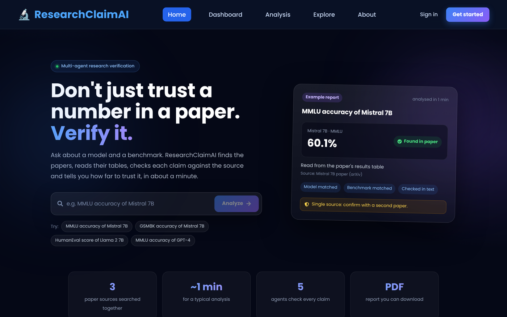
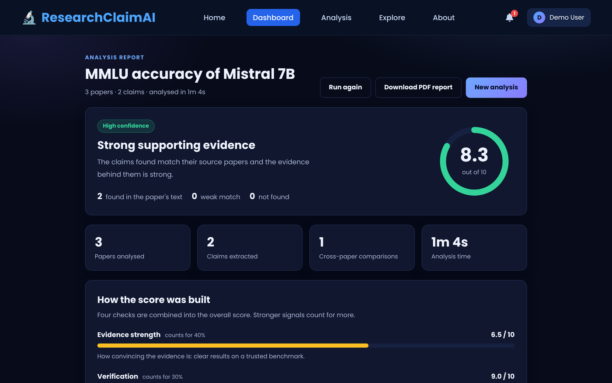
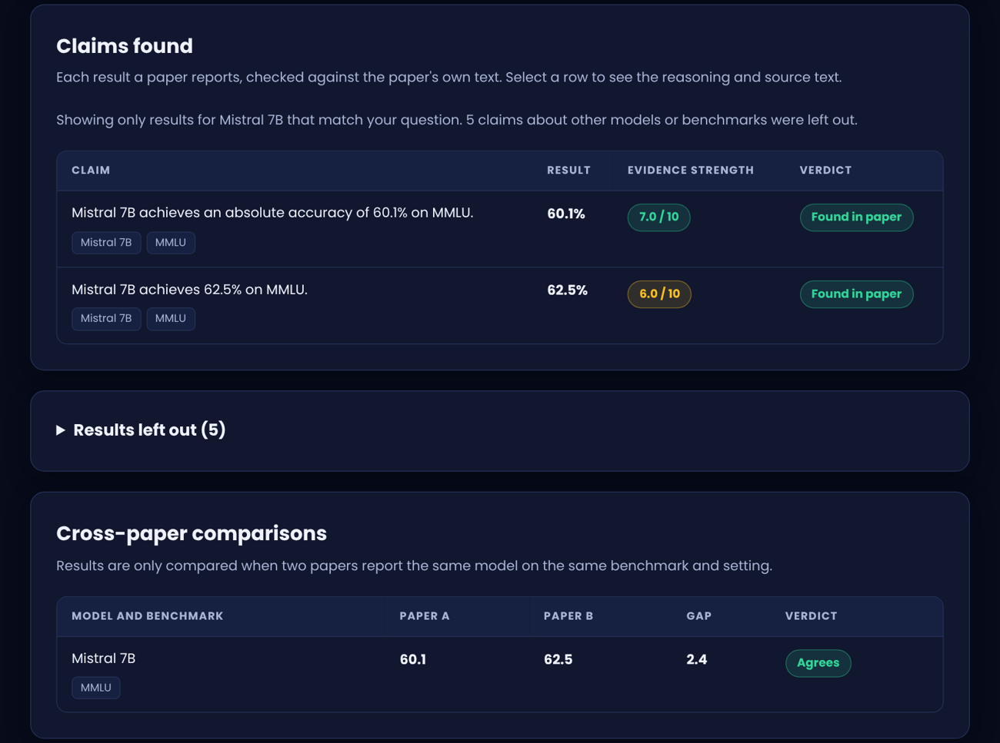
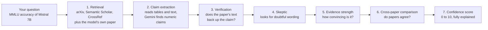
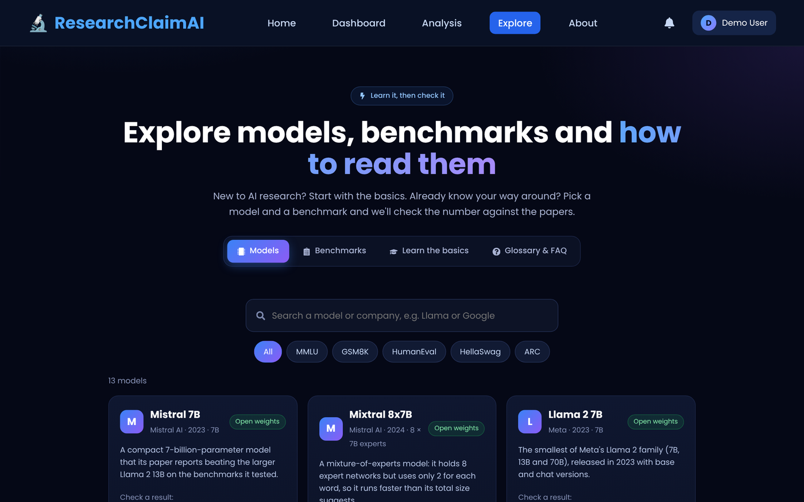

<div align="center">

# ResearchClaimAI

### Don't just trust a number in a paper. Verify it.

An intelligent multi-agent framework for autonomous analysis and verification of research claims across multiple papers.




</div>

---

## What is this?

AI research papers are full of numbers: *"Model X scores 60.1% on benchmark Y."*
Anyone who wants to rely on one of those numbers has to find the paper, dig
through its tables, and check whether other papers say the same thing. That
takes a long time, and it is easy to grab the wrong row (a different model, a
different benchmark, a different test setting).

**ResearchClaimAI does that checking for you.** You ask a question in plain
English, such as *"MMLU accuracy of Mistral 7B"*. In about a minute it:

1. finds the relevant research papers,
2. reads their results tables and text,
3. pulls out the numbers that answer your question,
4. checks each number against the paper's own wording,
5. compares different papers that report the same result, and
6. gives you a **confidence score from 0 to 10**, with every part of that score explained.

If it cannot find a trustworthy answer, it says **"No results found"** instead of guessing.

> **New to AI research?** The site has an **Explore** page that explains
> models, benchmarks and the jargon in simple language.

---

## See it in action

**You ask:** `MMLU accuracy of Mistral 7B`

**You get:**





In this example, two different papers reported Mistral 7B's MMLU score (60.1%
and 62.5%). They are within 3 points of each other, so the system marks them as
**agreeing** and gives the answer higher confidence. *(Screenshots use values
from a real run.)*

---

## How it works



| Step | What it does, in plain words |
|---|---|
| **1. Retrieval** | Searches three paper sources at once and also fetches the asked model's own paper directly, so the most important source is never missed. |
| **2. Claim extraction** | Reads abstracts and full PDFs, including results tables, and uses Google Gemini to pull out numeric benchmark claims. A rule-based validator throws away anything the paper text does not support. |
| **3. Verification** | Checks each claim against the paper's own sentences. |
| **4. Skeptic** | A simple keyword check for doubtful or contradicting wording. |
| **5. Evidence strength** | Scores how convincing the evidence is using a fixed rubric (clear metric, standard benchmark, released code, and so on). |
| **6. Cross-paper comparison** | Compares two papers only when they report the **same model on the same benchmark and setting**, so unrelated numbers are never mixed. |
| **7. Confidence** | Combines everything into one score and shows each part. |

### How the confidence score is built

| Part | Weight |
|---|---|
| Evidence strength | 40% |
| Verification in the paper | 30% |
| Agreement with other papers | 20% (5/10, neutral, when no other paper reports the result) |
| Skeptic review | 10% |

**High** is 8 or above, **Medium** is 6 or above, anything lower is **Low**.
A result from a single paper cannot reach High: High needs a second paper to agree.

### Built to be trustworthy

- **Answers the model you asked about.** Ask about Gemma 2 27B and results for
  Gemma 3, Gemma 2 9B or other benchmarks are shown separately under
  "Results left out", never mixed into your answer.
- **Says when it does not know.** "No results found" plus the closest related
  results, never a guess.
- **Labels weak evidence.** Single-source results and sub-component scores
  carry a visible warning.
- **Repeatable.** Every language-model answer is saved, so asking the same
  question about the same paper text always gives the same result.

---

## What you can ask

Questions follow the pattern **"&lt;benchmark&gt; of &lt;model&gt;"**.

- **Benchmarks:** MMLU, MMLU-Pro, GSM8K, HumanEval, HellaSwag, TruthfulQA, BIG-Bench, BBH
- **Models with their own paper built in:** Mistral 7B, Mixtral, Llama 1/2/3,
  Code Llama, GPT-3/4, Gemma 1/2/3, Gemini, Phi-3, Qwen2/2.5, DeepSeek-V3/R1,
  Falcon, PaLM, Yi, OLMo. Other models work through search only.

Examples to try: `MMLU accuracy of Mistral 7B`, `GSM8K accuracy of Mistral 7B`,
`HumanEval score of Llama 2 7B`, `MMLU accuracy of GPT-4`.



---

## Features

- Public landing page, sign-in popup for visitors, accounts with search history
- **Explore** page: model profiles, benchmark guide with example questions, glossary and FAQ
- Live progress while an analysis runs (about 45 to 80 seconds)
- Saved reports: a repeated question opens instantly; **Run again** re-checks the papers
- Dashboard: confidence ring, score breakdown, claims table with sources,
  results left out, cross-paper comparisons, papers analysed
- Download the report as a PDF

---

## Quick start

You need **Python 3.10+**, **Node 18+** and a free
[Gemini API key](https://aistudio.google.com/apikey).

**1. Backend**

```bash
cd backend
python -m venv venv
# Windows:  venv\Scripts\activate        macOS/Linux:  source venv/bin/activate
pip install -r ../requirements.txt
cp .env.example .env        # Windows: copy .env.example .env
# open .env and add your GEMINI_API_KEY
uvicorn main:app --reload
```

The API runs at http://127.0.0.1:8000 (check `/api/health`).

| `.env` value | Needed | Purpose |
|---|---|---|
| `GEMINI_API_KEY` | yes | claim extraction and evidence scoring |
| `SEMANTIC_SCHOLAR_API_KEY` | recommended | free key from semanticscholar.org/product/api, avoids rate-limit waits |
| `CORS_ORIGINS` | optional | extra frontend addresses allowed to call the API |

Never commit your real `.env` file.

**2. Frontend** (in a second terminal)

```bash
cd frontend
npm install
npm run dev
```

Open http://localhost:5173, sign up, and search **"MMLU accuracy of Mistral 7B"**.

On a network that reports a certificate error during `npm install` (Windows
PowerShell), run `$env:NODE_OPTIONS="--use-system-ca"` once in the same
terminal first.

---

## API

| Method | Path | Purpose |
|---|---|---|
| `POST` | `/api/jobs` | Start an analysis. Body: `{"query": "...", "max_results": 5, "refresh": false}` |
| `GET` | `/api/jobs/{job_id}` | Progress, then the full report when `status` is `done` |
| `GET` | `/api/health` | Health check |
| `GET` | `/api/catalog` | Models that have their own paper built in |

Finished reports are saved for 7 days in `backend/data/analysis_cache.json`
(ignored by git). Send `"refresh": true` to skip the saved copy.

---

## Project layout

```
backend/
  main.py                       FastAPI app, background jobs, saved reports
  retrievers/
    unified_retriever.py        parallel search, ranking, model-aware filtering
    known_papers.py             each model's own paper (and related papers) by arXiv ID
    query_model.py              finds the model named in a question
    retrieval_adapter.py        PDF download and text extraction
    claim_extraction_agent.py   Gemini extraction, validation, table readers
    evidence_strength_agent.py  anchored evidence-strength rubric
    contradiction_agent.py      cross-paper comparison
    confidence_scoring.py       weighted aggregation
    llm_utils.py                Gemini calls with retries and saved answers
    test_pipeline.py            run_pipeline(): the whole pipeline
  agents/                       evidence verification and skeptic agents
frontend/src/
  pages/                        Home, Analysis, Explore, Dashboard, Account, About, Login, SignUp
  components/                   navbar, footer, loading screen, sign-in popup
  services/                     API client, accounts, search history
  utils/                        report helpers, PDF export
docs/
  TEST_RESULTS.md               queries run against the system, compared with the papers
```

---

## Known limitations

We list these openly, because a tool that checks claims should be clear about its own.

- **One analysis at a time.** A second request waits until the first finishes.
- **Table reading depends on the PDF.** Results in images, or in table layouts
  the extractor does not recognise, can be missed.
- **Many answers rest on a single paper.** Cross-paper agreement appears only
  when a second retrieved paper reports the same model, benchmark and setting.
- **The skeptic check is a keyword check**, so a high skeptic score only means
  no doubtful wording was found.
- **Accounts are demo-grade.** Passwords are hashed in the browser and history
  is stored per browser. A production version would use server-side
  authentication and a database.
- **Results are a research aid.** Always confirm important numbers in the
  original paper.

## Test results

[`docs/TEST_RESULTS.md`](docs/TEST_RESULTS.md) lists the queries we ran and how
each result compares with the number published in the paper.

---

## The team

Built at **CHRIST (Deemed to be University)**, Department of Computer Science.

| | |
|---|---|
| **Team** | Adithya Ajith, Malavika Krishna, Sheethal Krishna K K |
| **Guide** | Dr. Sindhu V |

*Licence: to be decided by the team.*
